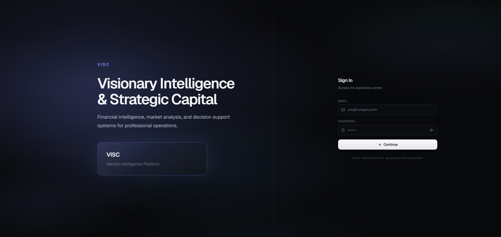
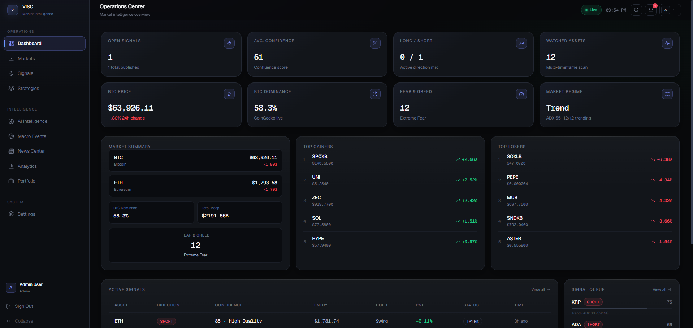
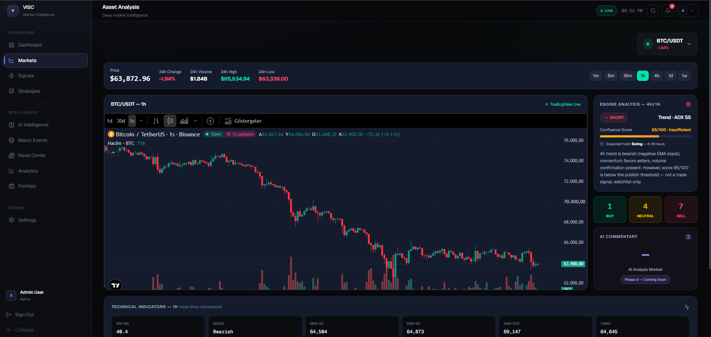
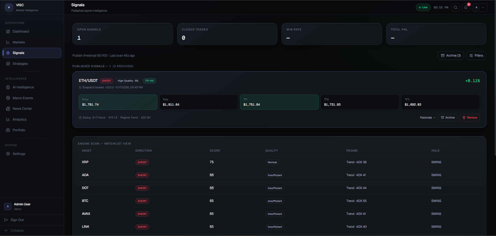
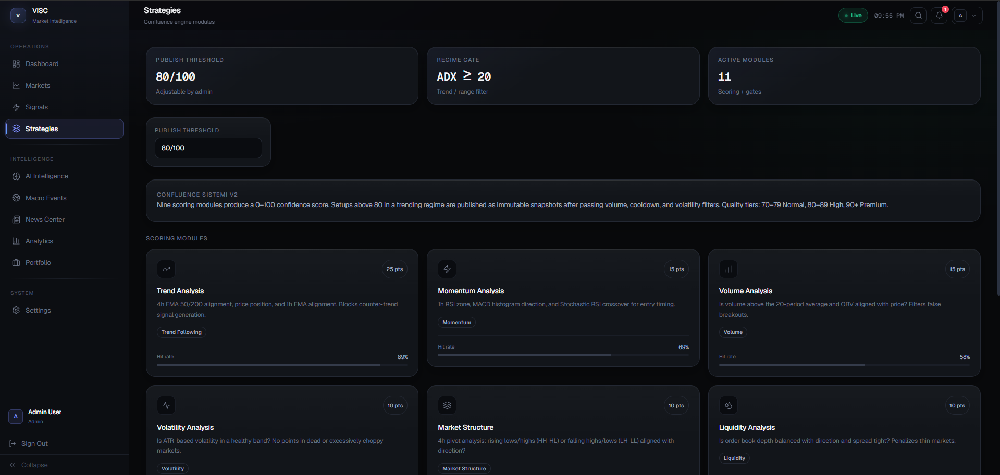

# VISC — Market Intelligence Platform

**VISC** (*Visionary Intelligence & Strategic Capital*) is a market intelligence and confluence signal platform built for professional operations desks.

It consumes **live public market data**, scores multi-module setups, publishes **immutable signal snapshots**, and tracks a **paper-trading lifecycle** inside a premium ultra-dark operations UI.

VISC does **not** place live exchange orders. It is a decision-support desk — not an auto-execution bot.

<p align="center">
  
</p>

<p align="center"><em>Split-screen access — brand narrative on the left, operations sign-in on the right.</em></p>

---

## Product gallery

### Operations Center

Live overview of confluence health, market regime, fear & greed, movers, and active paper signals — dense, calm, and built for scanning at a glance.

<p align="center">
  
</p>

### Asset Analysis

Deep asset workspace with live price context, TradingView charting, engine rationale, and technical indicator panels.

<p align="center">
  
</p>

### Signals

Published snapshots with locked entry / stop / scaled take-profits, quality tiers, regime metadata, archive controls, and the live watchlist scan table.

<p align="center">
  
</p>

### Strategies

Confluence engine v2 — publish threshold, regime gate, and the scoring module grid (trend, momentum, volume, volatility, structure, liquidity, and more).

<p align="center">
  
</p>

---

## Design language

| Principle | How it shows up |
|-----------|-----------------|
| Ultra-dark canvas | Deep `#08090B` shell — less glare, more focus on data |
| Soft accent, not neon noise | Cool indigo (`#7B8CFF`) for chrome; green/red reserved for market outcomes |
| One operations desk | Sidebar sections for Operations / Intelligence / System |
| Signal clarity | Snapshot cards lock levels; status badges and PnL stay readable at a glance |
| Atmosphere without clutter | Ambient glow on login and restrained card depth in the panel |

---

## What works today

- Live market data from public Binance APIs (spot REST/WebSocket; public futures funding / open interest where used)
- Confluence signal engine running inside the **Next.js** app (API route handlers)
- Immutable published signal snapshots with paper lifecycle monitoring (entry / stop / take-profit / expiry simulation on candle data)
- Operations UI: dashboard, markets, signals, strategies, coin analysis, analytics views
- FastAPI backend skeleton (auth/CRUD models) available under `backend/`, **not yet wired** into the main frontend flow
- Local JSON persistence for published signals (`frontend/data/` — gitignored)

---

## Architecture (current)

```
Browser → Next.js (UI + /api/signals orchestration)
              ├── Signal engine + indicators
              ├── Paper lifecycle monitor
              ├── JSON store (frontend/data/)
              └── Public market data (Binance, CoinGecko proxy, Fear & Greed)

FastAPI (backend/) → optional / future integration
PostgreSQL / Redis → provisioned in Docker Compose; not used by the live Next.js signal path today
```

| Component | Role today |
|-----------|------------|
| Next.js frontend | Primary product surface and signal engine host |
| FastAPI backend | Scaffold API; not integrated into the main UI flow |
| PostgreSQL / Redis | Present in Compose; **not active** in the current product data path |
| Paper monitor | Updates signal status from public candle highs/lows — no exchange orders |

---

## Tech stack

### Frontend
- Next.js 16 (App Router), React 19, TypeScript
- Tailwind CSS, Framer Motion, Recharts, Zustand
- TradingView chart embed / charting for analysis views

### Backend (scaffold)
- FastAPI, SQLAlchemy, Pydantic
- JWT helpers (not production-hardened in the current demo UI auth)

### Infrastructure
- Docker & Docker Compose (optional full stack)

---

## Repository layout

```
├── frontend/                 # Next.js UI + signal engine + API routes
│   ├── src/app/              # Pages + Route Handlers (/api/…)
│   ├── src/lib/              # Engine, Binance client, store helpers
│   └── data/                 # Local signal store (gitignored)
├── backend/                  # FastAPI scaffold (not primary runtime path)
│   ├── app/
│   ├── .env.example
│   └── requirements.txt
├── screenshots/              # Product UI captures for documentation
├── docker-compose.yml
├── .gitignore
└── README.md
```

---

## Requirements

- Node.js 20+
- Python 3.11+ (for the optional FastAPI scaffold)
- Docker & Docker Compose (optional)

---

## Getting started

### Frontend (primary way to run the product)

```bash
cd frontend
npm install
npm run dev
```

Open [http://localhost:3000](http://localhost:3000).

The signal scan, publish, and paper monitor run through Next.js routes such as `/api/signals`.

### Backend scaffold (optional)

```bash
cd backend
python -m venv venv
# Windows: venv\Scripts\activate
# macOS/Linux: source venv/bin/activate
pip install -r requirements.txt
cp .env.example .env
# Edit .env and replace every CHANGE_ME / placeholder value
uvicorn app.main:app --reload
```

API docs (when backend is running): [http://localhost:8000/api/docs](http://localhost:8000/api/docs)

> Note: the frontend does not currently call this API for login or signals. Local demo auth is client-side only.

### Docker Compose (optional)

`DB_PASSWORD` **must** be set; Compose will fail if it is missing.

```bash
# Windows PowerShell example
$env:DB_PASSWORD = "your-local-password"
# macOS/Linux example
# export DB_PASSWORD=your-local-password

cp backend/.env.example backend/.env
# Fill placeholders in backend/.env before starting
docker compose up -d
```

| Service | URL |
|---------|-----|
| Frontend | http://localhost:3000 |
| Backend API | http://localhost:8000 |
| Swagger | http://localhost:8000/api/docs |

---

## Demo access (development only)

The panel uses **demo authentication** for local exploration. It is **not** production-grade:

- Client-side session only (not server-enforced JWT for Next.js APIs)
- Any email with a password of at least 6 characters can sign in for demo purposes
- Admin-style UI gates are email-based demos, not hardened RBAC

Do not treat demo login as a security boundary.

---

## Product surfaces

| Area | Path | Status |
|------|------|--------|
| Dashboard | `/dashboard` | Live scan / market widgets |
| Markets | `/markets` | Live tickers + scan context |
| Signals | `/signals` | Published snapshots + paper lifecycle |
| Strategies | `/strategies` | Engine module documentation + threshold UI |
| Coin analysis | `/coin-analysis` | Charts + indicator panel |
| Analytics | `/analytics`, `/statistics` | Scan-derived views; historical depth still limited |
| AI Intelligence | `/ai-intelligence` | Context metrics; AI confirmation not active |
| News | `/news` | Demo / placeholder content |
| Macro Events | `/macro-events` | Demo / placeholder content |
| Portfolio | `/portfolio` | Placeholder (no exchange linking) |
| Settings | `/settings` | Demo UI |
| Login | `/login` | Demo authentication |

---

## Known Limitations & Future Improvements

These are planned engineering areas, not statements that the current intelligence desk is unusable:

- **Authentication & API security** should be hardened (server-side sessions, protected route handlers, proper role checks).
- **Automated test coverage** should be added for the signal engine, publish filters, and paper monitor edge cases.
- **Persistence** should move beyond local JSON files toward a more durable store suitable for multi-instance deployments.
- **Background jobs** for scanning and monitoring should eventually run independently of request-driven Next.js route handlers.
- FastAPI, PostgreSQL, and Redis remain available as integration targets; they are not on the hot path of the current UI.
- AI confirmation, live portfolio brokerage, and real news/macro feeds are future product layers.
- Live order execution is intentionally out of scope for the current release.

---

## Security notes for contributors

- Never commit `backend/.env`, `frontend/data/`, virtualenvs, or `node_modules`.
- Copy `backend/.env.example` → `backend/.env` and replace placeholders locally.
- Do not publish real secrets, API keys, or production passwords in issues or docs.

---

## License

All rights reserved © VISC
